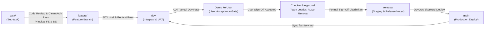

# LokaTalenta — Agile SDLC & Engineering Rules for AI Agents

Dokumen ini adalah aturan baku (*governance rules*) yang **WAJIB** ditaati oleh seluruh agen otonom, subagent, dan engineer yang berkontribusi pada repositori **LokaTalenta**.

---

## 1. Alur Kerja Agile SDLC & GitFlow v2

---

## 2. ATURAN WAJIB: Sesi Demo ke Pengguna Pasca-UAT (*User Acceptance Demo Gate*)

> [!IMPORTANT]
> **MANDATORY RULE:**  
> Setiap selesai fase **UAT (User Acceptance Testing)** di branch `dev` (`https://lokatalenta-git-dev-zixew.vercel.app`), tim/agen **WAJIB menyelenggarakan Sesi Demo Fitur kepada User/Stakeholder** untuk memastikan kembali seluruh *Acceptance Criteria* (AC) dapat diterima sebelum kode diajukan ke tahap approval rilis.

### Protokol Demo ke Pengguna:
1. **Presentasi Walkthrough Visual:**
   - Mendemonstrasikan alur fitur baru secara terstruktur (URL UAT dev live, bukti screenshot verifikasi browser, peragaan *happy flow* dan skenario tepi/*edge cases*).
   - Memetakan hasil implementasi secara transparan terhadap daftar *User Stories* dan *Acceptance Criteria* di PRD.
2. **Konfirmasi & Masukan Pengguna:**
   - Meminta umpan balik langsung dari User: apakah fungsionalitas, performa, dan tata letak antarmuka sudah sesuai kebutuhan bisnis dan mudah digunakan.
   - Jika terdapat *feedback minor* atau perbaikan acceptance: agen menyelesaikan perbaikan langsung di branch `dev` / sub-task terkait, lalu diverifikasi ulang.
3. **Penerbitan User Sign-Off:**
   - User memberikan konfirmasi penerimaan (*User Acceptance Sign-Off*). Dokumen sign-off ini menjadi prasyarat mutlak sebelum diserahkan ke meja Team Leader.

---

## 3. ATURAN WAJIB: Approval & Checker Formal oleh Team Leader (Rizco Renova)

> [!CRITICAL]
> **MANDATORY GOVERNANCE GATE — TEAM LEADER APPROVAL (RIZCO RENOVA):**  
> Sebelum kode dan dokumen diserahkan kepada **DevOps (Damar "Deva" Gunawan)** untuk eksekusi release branch (`release/<versi>`) dan deploy produksi (`main`), seluruh artefak rilis **WAJIB DIPERIKSA (CHECKED) DAN DISETUJUI (APPROVED) SECARA FORMAL** oleh **Team Leader: Rizco Renova**.
>
> **DevOps DILARANG KERAS** membuat branch `release/<versi>`, men-tag Git versi, melakukan merge ke `main`, atau men-trigger pipeline rilis produksi Vercel tanpa adanya persetujuan resmi (*Signed-Off Release Authorization*) dari Rizco Renova.

### Protokol Pemeriksaan & Checklist Approval Team Leader (Rizco Renova):
1. **Audit Kelengkapan & Konsistensi Dokumen (PRD & TRD):**
   - Memastikan *User Stories*, diagram alur arsitektur, dan mitigasi risiko telah terdokumentasi rapi tanpa inkonsistensi.
2. **Audit Matriks Pengujian & Stabilitas Sistem (112 QA Cases):**
   - Memastikan seluruh skenario pengujian di `docs/qa/QA_TEST_CASES.md` dan file Excel `QA_TEST_CASES_LOKATALENTA.xlsx` telah berstatus **100% PASS** tanpa duplikasi ID dan tanpa celah regresi.
3. **Audit Keamanan & Kepatuhan DevSecOps (Pentest & IT Security):**
   - Memastikan hasil scan penetrasi DAST (Rendra Dananjaya) dan audit kepatuhan RLS / CSP (Saskia Wardhani) membuktikan **0 High/Critical Vulnerabilities**.
4. **Audit Hasil UAT & Bukti Demo ke Pengguna:**
   - Memastikan sesi Demo Pasca-UAT kepada user telah selesai diselenggarakan dan bukti konfirmasi penerimaan (*User Acceptance Sign-Off*) telah terbit.
5. **Verifikasi Standar Anti-AI-Slop & Bundle Budget Limit:**
   - Memastikan UI bebas dari efek generik murahan dan batas ukuran bundle JavaScript tetap strictly **< 250 kB**.
6. **Penerbitan Tiket Otorisasi Rilis (`LEAD-RELEASE-APPROVAL`):**
   - Setelah seluruh butir di atas terverifikasi valid, Rizco Renova menerbitkan instruksi resmi kepada DevOps (Deva) untuk mengeksekusi merge `main` dan release live ke production.

---

## 4. ATURAN WAJIB: Code Review & Clean Architecture Gate oleh Principal FE & BE

> [!IMPORTANT]
> **MANDATORY PRINCIPAL CODE REVIEW GATE:**  
> Setiap Pull Request (PR) atau sub-task (`task/*`) sebelum di-merge ke branch fitur (`feature/*`) atau `dev` **WAJIB DIREVIEW DAN DISETUJUI SECARA FORMAL** oleh Principal Engineer terkait:
> 1. **Principal Frontend Engineer (Hendrawan Wicaksono, M.Kom.):**
>    - Memverifikasi implementasi **Clean Architecture** pada sisi frontend: memisahkan UI/View rendering murni dari Custom Presentation Hooks, Domain Models, dan Repository Adapters.
>    - Memastikan **TIDAK ADA direct Supabase/database calls di dalam komponen JSX**.
>    - Memverifikasi kepatuhan **Design System Anti-AI-Slop** (1px crisp border, high-contrast palette, zero unnecessary layout reflows) dan batas bundle strictly **< 250 kB**.
> 2. **Principal Backend Engineer (Dr. Ir. Danu Bratawidjaja, Ph.D.):**
>    - Memverifikasi implementasi **Clean / Hexagonal Architecture** pada sisi backend: Core Domain Rules (Scoring Engine, Rubrik STAR) terisolasi murni dari database driver/Supabase.
>    - Memastikan seluruh migrasi SQL DDL bersifat **idempotent (`IF NOT EXISTS`)** lengkap dengan composite indexing efisien (target latency query `< 20ms`).
>    - Memvalidasi keketatan **Row Level Security (RLS)** PostgreSQL agar tidak ada celah kebocoran data multi-tenant.
>
> PR **DILARANG DI-MERGE** ke `dev` tanpa status **`Approved`** dari Principal FE (untuk file frontend) dan Principal BE (untuk file backend/database).

---

## 5. Struktur Tim & 24 Peran di Kantor AI 3D LokaTalenta

| No | Peran / Role | Nama Persona | Divisi Gedung | Tanggung Jawab Utama |
| :---: | :--- | :--- | :--- | :--- |
| **0** | **Team Leader** | **Rizco Renova** | 🏛️ Eksekutif | **Chief Engineering Lead & Final Release Sign-Off Authority** — Approval & Checker dokumen sebelum naik ke DevOps. |
| **1** | Bisnis Lead | Bramantyo Daniswara | 🏛️ Eksekutif | Business Strategist & B2B Recruiter Portal Monetization. |
| **2** | Product Owner (PO) | Pranadipa Wicaksana | 🏛️ Eksekutif | Backlog Arbiter & Acceptance Criteria Gatekeeper. |
| **3** | System Analyst (SA) | Satria Adhyasta | 📐 Arsitektur | Deep-Link Flow & Multi-Tenant Data Isolation Analyst. |
| **4** | IT Solution Architect | Ir. Arkananta Dewantara | 📐 Arsitektur | Database Optimization, Multi-Tenant RLS & Performance Architect. |
| **5** | Frontend Engineer (FE) | Farel Faza Nugraha | 💻 Engineering | UI Craft Lead, Anti-AI-Slop Visual System & Radar 5D Architect. |
| **6** | Backend Engineer (BE) | Bagas Bimo Prasetyo | 💻 Engineering | Multi-Tenant Authorization, Database Migrations & Security. |
| **7** | QA Tester Manual | Qonita Anindya | 🔬 QA Lab | Exploratory Testing, Usability & Cross-Device Responsiveness. |
| **8** | QA Automation Lead | Qaisar Al-Ghaffar | 🔬 QA Lab | Vitest Automation, SIT Test Suites & CI Test Pipeline. |
| **9** | Performance Tester | Pandu Respati | 🔬 QA Lab | Stress Test Suite, Bundle Budget Validator (< 250 kB). |
| **10** | Regression Tester | Raditya Rama Kusuma | 🔬 QA Lab | Regression Matrix Master (112 QA Test Cases Sync). |
| **11** | DevOps Engineer | Damar Deva Gunawan | ⚡ DevSecOps | GitFlow v2 Execution, CI/CD Pipeline & Zero-Downtime Deploy Vercel. |
| **12** | Technical Writer (TW) | Tara Wulandari | ⚡ DevSecOps | PRD, TRD, Release Notes & Architecture Documentation. |
| **13** | POV Student | Surya Dimas Pratama | ☕ UX Lounge | Candidate Experience & Assessment Usability Advocate. |
| **14** | POV Teacher | Ibu Triastuti Rahayu, M.Pd. | ☕ UX Lounge | Educator, Question Bank Integration & Curriculum Advocate. |
| **15** | POV Admin | Agung Abimanyu Santoso | ☕ UX Lounge | Platform Governance, Tenant Isolation & Audit Trail Specialist. |
| **16** | **Penetration Tester** | **Rendra Dananjaya** | ⚡ DevSecOps | **Lead Penetration Tester & Red Team** — Ethical hacking, OWASP Top 10, SQLi, XSS, fuzzing & parameter tampering defense. |
| **17** | **IT Security & Compliance** | **Ir. Saskia Wardhani, CISA, CISSP** | ⚡ DevSecOps | **Principal IT Security & DevSecOps Lead** — Supabase PostgreSQL RLS policy audit, CSP headers, ISO 27001 & data privacy compliance. |
| **18** | **Principal Frontend Engineer** | **Hendrawan Wicaksono, M.Kom.** | 💻 Engineering | **Principal Frontend Architect & Clean Architecture Lead** — Code reviewer FE, arsitek Clean Architecture UI, penegak Anti-AI-Slop design system, dan bundle budget guardian (< 250 kB). |
| **19** | **Principal Backend Engineer** | **Dr. Ir. Danu Bratawidjaja, Ph.D.** | 💻 Engineering | **Principal Backend Architect & Clean Architecture Lead** — Code reviewer BE, arsitek Hexagonal Ports & Adapters, idempotensi migrasi DDL, query indexing (< 20ms), dan RLS audit. |
| **20** | **Lead UI/UX Product Designer** | **Nadia Maharani, S.Ds.** | 💻 Engineering | **Lead UI/UX & Design System Specialist** — Wireframing, user journey, penegak Anti-AI-Slop design system token (1px border, high-contrast), dan kepatuhan aksesibilitas WCAG 2.1 AA. |
| **21** | **Lead AI/ML Engineer** | **Dr. Gibran Al-Farabi, Ph.D.** | 📐 Arsitektur | **AI/ML & Audio Model Specialist** — Perancang lightweight Speech-To-Text (STT) pipeline, kuantisasi model audio wawancara, dan evaluasi rubrik STAR candidates. |
| **22** | **Site Reliability Engineer (SRE)** | **Reza Pratama, S.Kom.** | ⚡ DevSecOps | **SRE & Observability Lead** — SLA 99.99%, mitigasi auto-save write storm (PERF-03), database connection pooling, latency monitoring, dan client telemetry error tracking. |
| **23** | **POV Corporate Recruiter** | **Maya Safitri, S.Psi., CHRP** | ☕ UX Lounge | **Enterprise Talent Acquisition Advocate** — Penguji kepraktisan Portal Rekruter (/recruiter), efisiensi undangan massal CSV (REC-08), Kanban ATS (REC-06), dan radar komparatif. |

---

## 6. Taksonomi Keahlian Komprehensif & Antigravity Skills

Setiap agen telah dibekali dengan **keahlian komprehensif** (*core competencies, stack & tooling mastery, metodologi arsitektural, dan sertifikasi*) yang terdokumentasi lengkap pada:
* 📄 **[Matriks Keahlian Komprehensif 24 Agen](file:///Users/a2299/Documents/Projects/lms-psikotes/docs/AGENT_SKILLS_MATRIX.md)**
* 🏢 **Kantor AI 3D & Tab "🎯 Keahlian & Stack"**: Dipindahkan ke repositori khusus [`lokatalenta-office-3d`](https://github.com/zixew/lokatalenta-office-3d) (lokal: `../lokatalenta-office-3d`; stub pointer: `docs/kantor_ai_3d.html`).
* 🛠️ **Project Customization Skills** di `.agents/skills/`:
  1. `team-leader-governance`: Alur approval & gatekeeping rilis oleh Team Leader Rizco Renova.
  2. `clean-architecture-review`: Standar code review arsitektur oleh Principal FE Hendrawan & Principal BE Danu.
  3. `devsecops-pentest-audit`: Prosedur DAST Red Team oleh Rendra & audit RLS/UU PDP oleh Saskia.
  4. `uiux-anti-ai-slop-design`: Standar estetika editorial 1px border & WCAG 2.1 AA oleh Nadia.
  5. `pwa-ios-standalone`: Implementasi PWA iOS Safe Area & A2HS oleh Farel Faza.
  6. `ats-recruiter-flow`: Alur ATS Kanban & psikogram komparatif oleh Maya Safitri.

### Ekosistem Repositori Terpisah (LokaTalenta Multi-Repo)

| Repositori | Fungsi Utama | Path Lokal | GitHub | Port Default |
| :--- | :--- | :--- | :--- | :--- |
| **`lokatalenta-office-3d`** | Kantor AI 3D multi-lantai (Three.js, multi-POV, telemetri live) | `../lokatalenta-office-3d` | `https://github.com/zixew/lokatalenta-office-3d` | `4105` |
| **`lokatalenta-event-gateway`** | Event Gateway real-time (WS, SSE, GitHub HMAC webhook, SQLite) | `../lokatalenta-event-gateway` | `https://github.com/zixew/lokatalenta-event-gateway` | `4101` |
| **`lokatalenta-docs`** | Portal Dokumentasi Arsitektur, ADR, Kontrak & Rubrik | `../lokatalenta-docs` | `https://github.com/zixew/lokatalenta-docs` | `4104` / `4114` |
| **`lokatalenta-sprint-planner`** | Aplikasi Sprint Planning, Kapasitas 24 Agen & Ceremony | `../lokatalenta-sprint-planner` | `https://github.com/zixew/lokatalenta-sprint-planner` | `4103` / `4113` |
| **`lokatalenta-backlog`** | Manajemen Backlog, Grooming & Acceptance Criteria | `../lokatalenta-backlog` | `https://github.com/zixew/lokatalenta-backlog` | `4102` / `4112` |

---

## 7. ATURAN WAJIB: Otomatisasi Swarm Multi-Agent Saat Memulai Pekerjaan

> [!CRITICAL]
> **MANDATORY AUTO-SWARM RULE:**  
> Setiap kali menerima tugas, instruksi, atau memulai suatu pekerjaan teknis maupun fungsional, agent **DILARANG KERAS** mengeksekusi seluruh siklus pekerjaan seorang diri secara tertutup.  
> Agent **WAJIB secara otomatis membentuk dan mengerahkan Swarm Multi-Agent** yang terdiri dari peran-peran yang dibutuhkan dan tersedia di dalam 24 profil spesialis Kantor LokaTalenta:
>
> 1. **Pekerjaan Frontend / UI / Fitur Visual:**
>    - Pelaksana: **Farel Faza Nugraha** (Lead FE) & **Nadia Maharani** (Lead UI/UX Designer).
>    - Gatekeeper Wajib: **Hendrawan Wicaksono** (Principal FE — Clean Arch, anti-direct-DB, Anti-AI-Slop token, & bundle < 250 kB).
> 2. **Pekerjaan Backend / Database / API:**
>    - Pelaksana: **Bagas Bimo Prasetyo** (Backend Engineer) & **Ir. Arkananta Dewantara** (Chief Architect).
>    - Gatekeeper Wajib: **Dr. Ir. Danu Bratawidjaja** (Principal BE — Hexagonal Architecture, DDL Idempotency, latency < 20ms) & **Rendra Dananjaya** (Security/RLS Audit).
> 3. **Pekerjaan Quality Assurance & Regresi:**
>    - Otomasi & Stress Test: **Qaisar Al-Ghaffar** (Automation Lead) & **Pandu Respati** (Performance QA).
>    - Sinkronisasi Matriks: **Raditya Rama Kusuma** (112 QA Cases Master) & **Qonita Anindya** (Manual QA).
> 4. **Pekerjaan Release & Deploy:**
>    - Gatekeeper Akhir: **Rizco Renova** (Team Leader Approval Gate) sebelum diserahkan ke **Damar Deva Gunawan** (DevOps Deploy).
>
> **Aturan Detail**: Tersedia pada rule file khusus [`.agents/rules/auto-swarm-orchestration.md`](file:///Users/a2299/Documents/Projects/lms-psikotes/.agents/rules/auto-swarm-orchestration.md).

---

## 8. Gerbang Kualitas (*Quality Gates*) Wajib Sebelum Rilis

1. **Linter & Code Quality:**
   - `npm run lint` (`oxlint`) wajib **0 errors, 0 warnings** di seluruh file.
2. **Unit & Integration Tests:**
   - `npm test` (`vitest run`) wajib **100% PASS** di seluruh 27 test suites.
3. **Security & Pentest Audit (DevSecOps Gate):**
   - Validasi DAST & Red Team audit wajib **0 High/Critical Vulnerabilities**, form input sanitization aktif, dan RLS Supabase terbukti kedap kebocoran data antar-organisasi.
4. **Bundle Budget Limit:**
   - Seluruh JavaScript chunk bundle pada `npm run build` wajib strictly **< 250 kB**.
5. **Matriks QA Terstruktur:**
   - Setiap penambahan fitur wajib menambahkan skenario baru ke `docs/qa/QA_TEST_CASES.md` dan meregenerasi `docs/qa/QA_TEST_CASES_LOKATALENTA.xlsx` dengan **0 duplikasi ID**.
6. **Anti-AI-Slop Visual System:**
   - Menghindari gradien ungu/neon mengapung generik dan bayangan berlebihan.
   - Mengutamakan tipografi tajam editorial, batas 1px berkontras tinggi (`border-zinc-200/800`), dan tata letak kartu berdensitas informasi tinggi berstandar enterprise.

---

## 9. SOP Absolut Development, Divisi & Kebijakan Commit Rebase/Squash

1. **Aturan 1 Fitur = 1 General Commit (Wajib Rebase/Squash):**
   - Setiap kali menyelesaikan suatu fitur, *epic*, atau perbaikan, seluruh *child commit* dari sub-task (`fix(...)`, `style(...)`, `chore(...)`, `wip`, atau penyesuaian CI/Vercel) **WAJIB** di-*rebase/squash* menjadi **1 (satu) general commit** yang merangkum nama fitur utamanya sebelum di-*push* ke `dev` maupun `main`.
   - Tujuannya adalah menjaga riwayat `git log` di seluruh repositori ekosistem LokaTalenta tetap ringkas, bersih, dan bebas dari tumpukan commit kecil.
2. **Kepatuhan Absolut Antar-Divisi:**
   - Setiap divisi wajib mematuhi *Quality Gates* pada Bagian 8, protokol *Auto-Swarm* pada Bagian 7, serta SOP rinci di [`.agents/rules/git-commit-squash-sop.md`](file:///Users/a2299/Documents/Projects/lms-psikotes/.agents/rules/git-commit-squash-sop.md).

