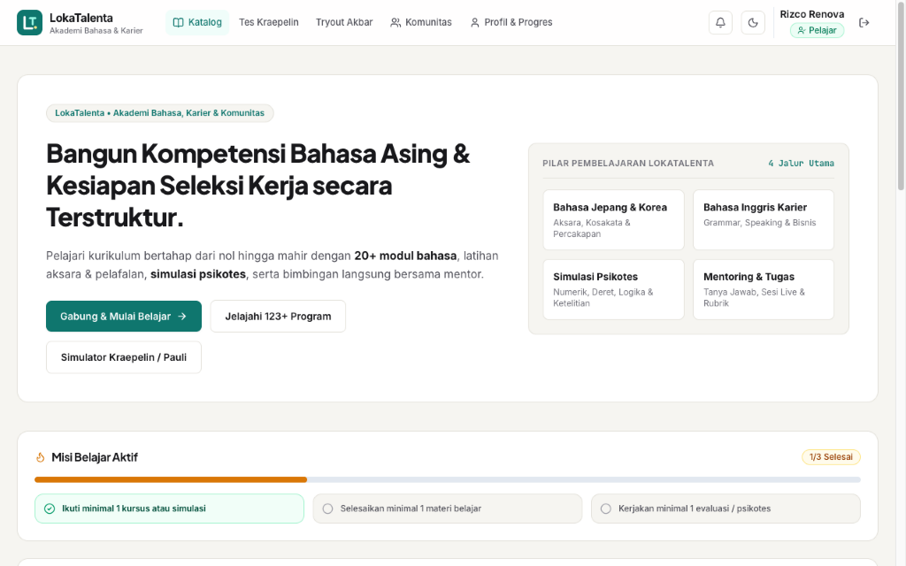
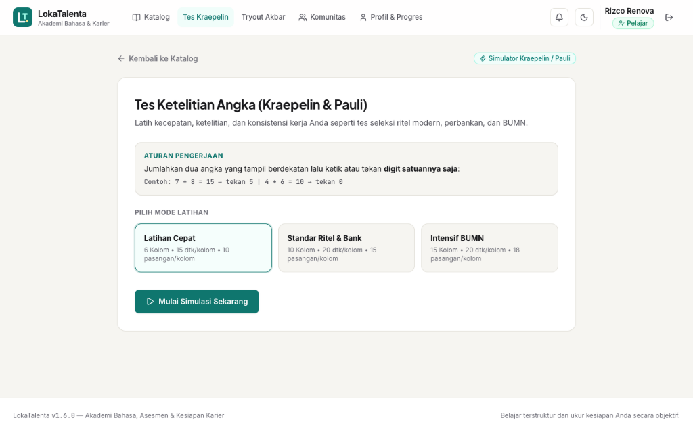
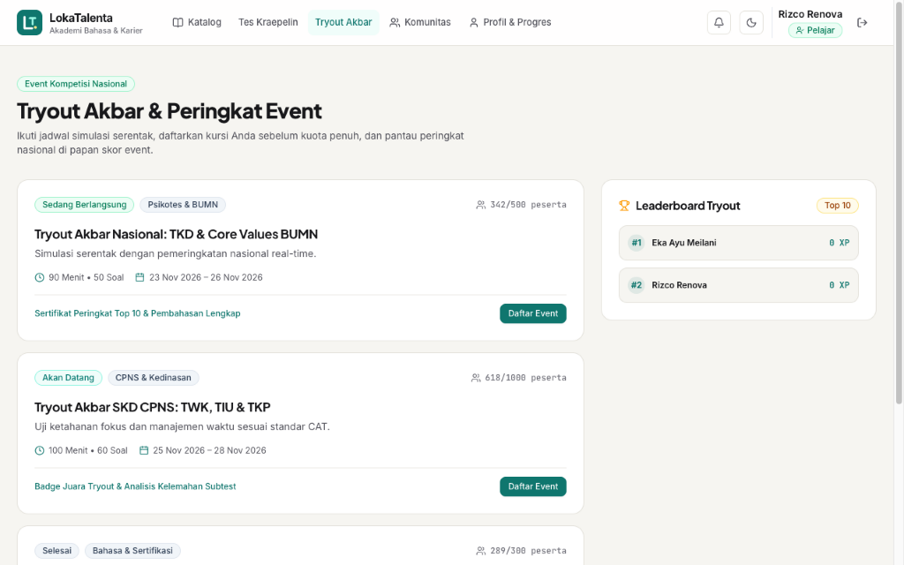
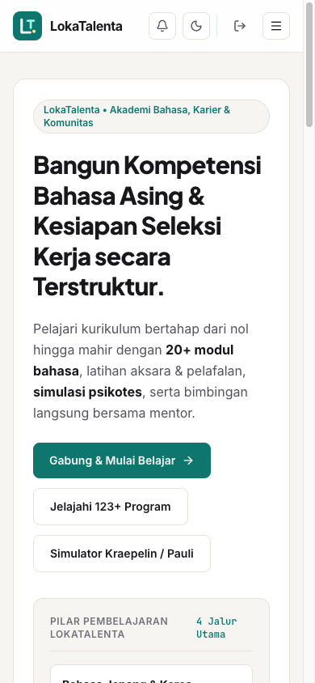

# ✨ LokaTalenta

**Platform Belajar Interaktif & Simulasi Psikotes Persiapan Karier**

LokaTalenta hadir untuk membantu pencari kerja, mahasiswa, dan profesional mempersiapkan diri menghadapi seleksi kerja dengan lebih percaya diri. Dari latihan psikotes terstruktur hingga penguasaan keterampilan kerja dan bahasa, seluruh proses belajar dirancang agar terasa terarah, terukur, dan menyenangkan.

---

## 📱 Preview UI LokaTalenta

Tampilan antarmuka **LokaTalenta** dirancang bersih, responsif, dan fokus pada kenyamanan belajar di desktop maupun perangkat mobile:

<table>
  <tr>
    <td width="50%" valign="top">
      <h4 align="center">1. Katalog Program &amp; Misi Belajar</h4>
      
      
Jelajahi 120+ program persiapan psikotes, bahasa, dan keterampilan kerja dengan filter pintar &amp; misi harian.

    </td>
    <td width="50%" valign="top">
      <h4 align="center">2. Simulasi Tes Kraepelin / Pauli</h4>
      
      
Latihan ketelitian &amp; ketahanan kerja dengan timer per kolom, numpad cepat, serta grafik akurasi.

    </td>
  </tr>
  <tr>
    <td width="50%" valign="top">
      <h4 align="center">3. Tryout Akbar &amp; Leaderboard</h4>
      
      
Ikuti jadwal simulasi nasional serentak, daftarkan kursi event, dan pantau papan peringkat Top 10.

    </td>
    <td width="50%" valign="top" align="center">
      <h4 align="center">4. Pengalaman Mobile Responsif</h4>
      
      
Nyaman diakses dari smartphone dengan navigasi ringkas dan 0px horizontal overflow.

    </td>
  </tr>
</table>

---

## 🎯 Untuk Siapa LokaTalenta?

- **Pencari Kerja & Fresh Graduate** — Berlatih menghadapi pola tes seleksi perusahaan ritel nasional maupun korporasi besar dengan simulasi waktu nyata dan pembahasan lengkap.
- **Pembelajar Mandiri** — Mengasah kemampuan komunikasi, bahasa, dan kesiapan kerja melalui materi ringkas serta latihan bertahap.
- **Pengajar & Mentor** — Menyusun kurikulum, membagikan pengumuman kelas, memberi nilai dan masukan tugas, serta mendampingi perkembangan peserta secara langsung.

---

## 🌟 Fitur Unggulan

### 🧠 Simulasi Psikotes & Evaluasi Terarah
- **Beragam Kategori Tes:** Verbal, Numerik, Logika, Spasial/Figural, hingga ketelitian kerja.
- **Pengalaman Ujian Nyata:** Dilengkapi pengatur waktu, navigasi soal yang jelas, serta variasi paket soal agar latihan selalu menantang.
- **Pembahasan Lengkap:** Setiap selesai mengerjakan latihan, peserta langsung mendapatkan skor, ringkasan hasil, dan penjelasan jawaban.

### 📚 Pembelajaran Bertahap & Interaktif
- **Kurikulum Terstruktur:** Materi disusun per modul dan topik sehingga mudah diikuti dari dasar hingga mahir.
- **Variasi Format Belajar:** Artikel ringkas, video materi, latihan audio, serta kartu pengingat (*flashcard*) untuk memperkuat daya ingat.

### 🏆 Gamifikasi yang Menjaga Semangat
- **Poin Pengalaman (XP) & Streak Harian:** Konsistensi belajar tercatat setiap hari.
- **Pencapaian & Papan Peringkat:** Kumpulkan lencana dari setiap progres dan lihat posisi belajar bersama peserta lain.

### 🎓 Sertifikat Kelulusan & Verifikasi Keaslian
- Peserta yang menyelesaikan kelas berhak mendapatkan **sertifikat digital**.
- Setiap sertifikat memiliki **kode verifikasi unik** yang keasliannya dapat dicek secara terbuka oleh perekrut maupun perusahaan.

### 💬 Komunitas Diskusi & Bimbingan Mentor
- Ruang diskusi interaktif untuk saling bertukar pikiran, bertanya seputar materi, dan memberi dukungan antarpelajar.
- Komunikasi langsung dengan pengajar melalui tanya jawab materi, pengumuman kelas, serta penilaian tugas yang disertai umpan balik.

---

## 👥 Pengalaman Sesuai Peran

| Peran | Fokus Utama |
| :--- | :--- |
| **Pelajar** | Menjelajahi katalog kelas, belajar mandiri, mengerjakan simulasi psikotes, berdiskusi di komunitas, dan meraih sertifikat. |
| **Pengajar / Mentor** | Mengelola kelas dan modul, menyusun bank soal latihan, memantau progres peserta, serta menilai tugas. |
| **Pengelola** | Menjaga kualitas konten, mengelola peran pengguna, dan memastikan seluruh aktivitas belajar berjalan lancar. |

---

  <strong>LokaTalenta</strong> — <em>Siapkan Langkah Terbaik Menuju Karier Impianmu.</em>

