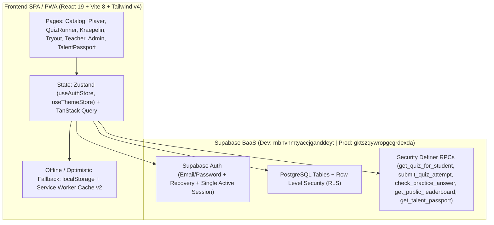

# Technical Requirements Document (TRD) — LokaTalenta (`v1.10.0` → `v2.0.0`)

**Dokumen:** Arsitektur Teknis, Skema Database, Kontrak API/RPC, & Standar Kualitas  
**Baseline:** `v1.9.1`  
**Target:** Sprint 7 (`v1.10.0`) s.d. Sprint 10 (`v2.0.0`)

---

## 1. Arsitektur Sistem Saat Ini & Target Evolusi



### Prinsip Arsitektur Wajib (*Non-Negotiable Constraints*)
1. **Dual-Mode Resilience (Supabase + Local Fallback):**
   - Setiap fitur yang menulis/membaca tabel baru di Supabase **wajib** memiliki fallback `try/catch` ke `localStorage` agar:
     - Mode Demo Lokal (SIT & unit test tanpa jaringan) tetap berjalan 100%.
     - Aplikasi tidak pernah mengalami *crash* (`HTTP 5xx` / uncaught error) apabila migrasi tabel pada salah satu environment belum dijalankan.
2. **Keamanan Kunci Jawaban (Anti-Cheat):**
   - Siswa tidak boleh memiliki akses `SELECT` langsung ke kolom `correct_option` pada tabel `public.questions`. Seluruh evaluasi jawaban wajib melalui RPC `SECURITY DEFINER` (`submit_quiz_attempt`, `check_practice_answer`).
3. **Performance & Bundle Budget:**
   - Setiap chunk JS hasil `vite build` wajib berada **di bawah 250 kB** (`react-vendor`, `supabase-vendor`, `query-vendor`, dan lazy-loaded route chunks).
4. **Zero-Warning Static Analysis:**
   - `oxlint` wajib `0 warnings, 0 errors` (pisahkan helper non-komponen ke file `.ts` tersendiri agar mematuhi `react(only-export-components)` dan hindari `setState` sinkron di dalam `useEffect`).

---

## 2. Desain Skema Database Baru (`supabase/migrations/`)

### 2.1. Migrasi Sprint 7 (`20261124080000_cloud_notes_and_preferences.sql`)
Menyimpan catatan materi (`lesson_notes`) dan preferensi belajar (`user_study_preferences`) per pengguna:

```sql
create table if not exists public.lesson_notes (
  id uuid primary key default gen_random_uuid(),
  user_id uuid not null references public.profiles(id) on delete cascade,
  lesson_id text not null,
  note_text text not null default '',
  updated_at timestamptz not null default now(),
  unique (user_id, lesson_id)
);

alter table public.lesson_notes enable row level security;

create policy "Users manage own lesson notes"
  on public.lesson_notes for all
  using (auth.uid() = user_id)
  with check (auth.uid() = user_id);

create table if not exists public.user_study_preferences (
  user_id uuid primary key references public.profiles(id) on delete cascade,
  learning_goal text not null default 'psikotes',
  daily_xp_target integer not null default 60,
  last_lessons jsonb not null default '{}'::jsonb,
  updated_at timestamptz not null default now()
);

alter table public.user_study_preferences enable row level security;

create policy "Users manage own study preferences"
  on public.user_study_preferences for all
  using (auth.uid() = user_id)
  with check (auth.uid() = user_id);
```

### 2.2. Migrasi Sprint 8 (`20261124090000_duel_and_kraepelin_history.sql`)
Menyimpan riwayat tantangan duel 1v1 (`quiz_challenges`) dan riwayat simulasi Kraepelin (`kraepelin_attempts`):

```sql
create table if not exists public.quiz_challenges (
  id uuid primary key default gen_random_uuid(),
  quiz_id text not null,
  challenger_name text not null,
  target_score integer not null,
  opponent_user_id uuid references public.profiles(id) on delete set null,
  opponent_name text not null,
  opponent_score integer not null,
  outcome text not null check (outcome in ('win', 'draw', 'lose')),
  created_at timestamptz not null default now()
);

alter table public.quiz_challenges enable row level security;

create policy "Anyone can read quiz challenges"
  on public.quiz_challenges for select
  using (true);

create policy "Authenticated users can insert quiz challenge results"
  on public.quiz_challenges for insert
  with check (auth.uid() is not null);

create table if not exists public.kraepelin_attempts (
  id uuid primary key default gen_random_uuid(),
  user_id uuid not null references public.profiles(id) on delete cascade,
  duration_seconds integer not null,
  total_answered integer not null,
  total_correct integer not null,
  accuracy_pct integer not null,
  speed_kpm numeric(6,2) not null,
  stability_score integer not null,
  created_at timestamptz not null default now()
);

alter table public.kraepelin_attempts enable row level security;

create policy "Users manage own kraepelin attempts"
  on public.kraepelin_attempts for all
  using (auth.uid() = user_id)
  with check (auth.uid() = user_id);
```

### 2.3. Migrasi Sprint 9 (`20261124100000_admin_audit_logs.sql`)
Menyimpan log audit admin di database:

```sql
create table if not exists public.admin_audit_logs (
  id uuid primary key default gen_random_uuid(),
  actor_id uuid references public.profiles(id) on delete set null,
  actor_name text not null,
  action text not null,
  target_label text not null,
  detail text not null,
  created_at timestamptz not null default now()
);

alter table public.admin_audit_logs enable row level security;

create policy "Admins can view and insert audit logs"
  on public.admin_audit_logs for all
  using (
    exists (
      select 1 from public.profiles p
      where p.id = auth.uid() and p.role = 'admin'
    )
  )
  with check (
    exists (
      select 1 from public.profiles p
      where p.id = auth.uid() and p.role = 'admin'
    )
  );
```

### 2.4. Migrasi Sprint 10 Major `v2.0.0` (`20261124110000_talent_passport_rpc.sql`)
RPC publik `get_talent_passport(p_user_id uuid)` (`SECURITY DEFINER`) untuk menampilkan **Talent Readiness Passport** kepada perekrut tanpa mengekspos data sensitif:
- Mengembalikan `full_name`, `role`, `xp`, `level`, `completed_lessons_count`, `passed_quizzes_count`, rata-rata skor psikotes, dan metrik Kraepelin terbaik.

---

## 3. Kontrak Komponen & Service Layer (`client/src/`)

| Modul | File Baru / Diperbarui | Fungsi & Kontrak Utama |
| :--- | :--- | :--- |
| **Player Notes Sync** | `src/features/player/lessonNotesStorage.ts` | `syncLessonNoteFromServer(userId, lessonId)`, `saveLessonNoteAsync(userId, lessonId, text)`, `exportCourseNotesMarkdown(course, userId)` |
| **Study Preferences** | `src/features/courses/learningGoalStorage.ts` | `syncStudyPreferences(userId)`, `saveStudyPreferencesAsync(userId, prefs)` |
| **Duel & Kraepelin** | `src/features/kraepelin/kraepelinHistory.ts` | `getKraepelinHistory(userId)`, `recordKraepelinAttempt(userId, summary)` |
| **Teacher Question Edit** | `src/shared/services/lmsApi.ts` & `TeacherStudioPage.tsx` | `lmsApi.updateQuestionInQuiz(questionId, payload)` + mode `editingQuestionId` di form Question Builder |
| **Admin Governance** | `src/features/admin/adminAuditLog.ts` & `AdminPanelPage.tsx` | `syncAdminAuditLogsFromServer()`, `exportAdminAuditCsv(logs)`, `exportAdminUsersCsv(profiles)` |
| **Talent Passport 2.0** | `src/features/talent/talentRadar.ts` & `TalentPassportPage.tsx` | `computeTalentRadarMetrics(...)`, komponen SVG Radar 5-Dimensi, rute publik `/talent/:userId` |

---

## 4. Strategi Pengujian & Quality Gates (SDLC)

Setiap Sprint wajib melewati 4 gerbang verifikasi:
1. **Static & Unit Gate (Local):**
   - `npm run lint` (`0 warnings, 0 errors`)
   - `npm test` (`100% pass` termasuk unit test sprint baru `sprint7Features.test.ts` s.d. `sprint10Features.test.ts`)
   - `npm run build` (`tsc -b && vite build` tanpa chunk > 250 kB)
2. **SIT Gate (`http://localhost:4179`):**
   - Pengujian fungsional di browser lokal menggunakan akun `Rizco` / `Admin` + pemeriksaan `0` console/page error.
3. **UAT Gate (`dev` → `https://lokatalenta-git-dev-zixew.vercel.app`):**
   - Merge `feature/*` ke `dev`, push ke `origin/dev`, tunggu deploy Vercel Dev, dan verifikasi live di browser.
4. **Staging & Release Gate (`prod` → `https://lokatalenta.vercel.app` → `main`):**
   - Merge `dev` ke `prod`, verifikasi di URL produksi, lalu merge ke `main` dan jalankan `./scripts/release.sh <minor|major> "<deskripsi>"`.
