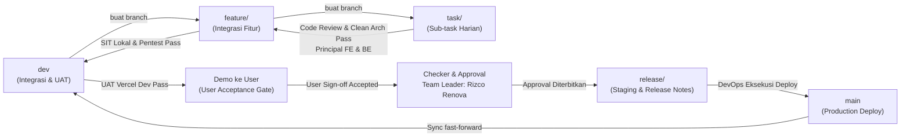

# Strategi Branching & Rilis LokaTalenta (GitFlow v2)

**Berlaku mulai:** `v1.9.1` → `v3.0.0+`  
**Perubahan Utama:** Branch `prod` dipensiunkan dan digantikan oleh branch **`release/<versi>`** (per rilis versi), sedangkan **`main`** resmi menjadi branch **Deploy Production**.

---

## 1. Alur Branching & Environment



---

## 2. Peran & Aturan Setiap Branch

| Branch | Sumber | Target Merge | Environment / URL | Fungsi & Aturan |
| :--- | :--- | :--- | :--- | :--- |
| **`main`** | `release/<versi>` / `hotfix/<nama>` | `dev` (sync) | **Production** (`https://lokatalenta.vercel.app`) | **Branch utama deploy production.** Tidak boleh commit fitur langsung; hanya menerima merge dari `release/<versi>` atau `hotfix/*` yang sudah teruji. |
| **`release/<versi>`** | `dev` | `main` & `dev` | **Staging / Preview** (`lokatalenta-git-release-...vercel.app`) | Contoh: `release/1.10.0`, `release/2.0.0`, `release/3.0.0`. Menyimpan *version bump*, `CHANGELOG.md`, dan **deskripsi lengkap pembaruan** pada commit & tag rilis. |
| **`dev`** | `main` (sync) | `release/<versi>` | **UAT** (`https://lokatalenta-git-dev-zixew.vercel.app`) | Branch integrasi harian dan **UAT**. Semua branch `feature/*` yang lulus SIT di-merge ke sini. |
| **`feature/<nama>`** | `dev` | `dev` | **SIT Lokal** (`http://localhost:4179`) | Branch per Epik/Sprint (mis. `feature/sprint7-cloud-notes-and-prefs`). Tempat menggabungkan seluruh `task/*` sebelum SIT. |
| **`task/<nama>`** | `feature/<nama>` | `feature/<nama>` | Lokal Dev | Branch untuk satu backlog item (mis. `task/bl-21-cloud-lesson-notes`). |
| **`hotfix/<nama>`** | `main` | `release/<X.Y.Z>` → `main` & `dev` | **Production** | Perbaikan darurat bug/issue yang ditemukan di **production** setelah development selesai. Masuk ke versioning **Hotfix (`X.Y.Z`, digit ke-3)**, mis. `1.9.1` → `1.9.2`. |

---

## 2A. Alur & Versioning Hotfix Production (`X.Y.Z`)

Jika terdapat issue di **Production (`main`)** setelah development selesai:
1. Buat branch `hotfix/<nama-issue>` langsung dari **`main`** (bukan dari `dev` yang mungkin sudah berisi fitur sprint berikutnya).
2. Perbaiki issue dan verifikasi (`npm run lint`, `npm test`, `npm run build`, serta uji lokal).
3. Jalankan script rilis dengan tipe **`hotfix`**:
   ```bash
   ./scripts/release.sh hotfix "Fix issue production: <deskripsi perbaikan>"
   ```
   Script akan menaikkan **digit ke-3 (`X.Y.Z`)**, membuat branch `release/<X.Y.Z>`, dan mencatat bagian `### Hotfix` di `CHANGELOG.md`.
4. Push `release/<X.Y.Z>` untuk verifikasi, lalu merge ke **`main`** (Production Deploy) dan sync ke **`dev`** agar perbaikan ikut masuk ke development berikutnya.

---

## 2B. Aturan Wajib: Sesi Demo ke Pengguna Pasca-UAT (*User Acceptance Demo Gate*)

> [!IMPORTANT]
> **Mandatory SDLC Rule:** Setiap selesai melakukan UAT di branch `dev` (`https://lokatalenta-git-dev-zixew.vercel.app`), tim/agen **WAJIB** menyelenggarakan **Sesi Demo Fitur kepada User / Stakeholder** untuk memastikan kembali seluruh *Acceptance Criteria* (AC) dapat diterima sebelum mempromosikan kode ke branch `release/<versi>` atau `main`.

### Protokol & Standar Demo ke Pengguna:
1. **Penyajian Demo Interaktif & Visual:**
   - Menyajikan alur fitur baru secara terstruktur (walkthrough fitur di URL UAT dev atau pratinjau interaktif, bukti tangkapan layar, dan peragaan happy flow & boundary cases).
   - Menjelaskan pemenuhan setiap item backlog, *User Story*, dan *Acceptance Criteria* (AC) yang disepakati.
2. **Validasi Acceptance & Penampungan Masukan:**
   - Meminta konfirmasi langsung dari pengguna: apakah fungsionalitas, performa, dan tata letak UI sudah sesuai harapan.
   - Jika ada catatan perbaikan atau feedback minor: agen/tim menyelesaikan perbaikan di branch `dev` atau task terkait dan memverifikasi ulang sebelum melangkah ke rilis.
3. **Gerbang Rilis (*User Acceptance Sign-Off Gate*):**
   - Branch `release/<versi>` **DILARANG** dibuat dan kode **DILARANG** dipromosikan ke `main` (Production) sebelum user memberikan konfirmasi penerimaan (*User Acceptance Sign-Off* / persetujuan rilis).

---

## 2C. Aturan Wajib: Approval & Checker Formal oleh Team Leader (Rizco Renova)

> [!CRITICAL]
> **MANDATORY GOVERNANCE GATE — TEAM LEADER APPROVAL (RIZCO RENOVA):**  
> Sebelum kode dan dokumen diserahkan kepada **DevOps (Damar "Deva" Gunawan)** untuk eksekusi release branch (`release/<versi>`) dan deploy produksi (`main`), seluruh artefak rilis **WAJIB DIPERIKSA (CHECKED) DAN DISETUJUI (APPROVED) SECARA FORMAL** oleh **Team Leader: Rizco Renova**.
>
> **DevOps DILARANG KERAS** membuat branch `release/<versi>`, men-tag Git versi, melakukan merge ke `main`, atau men-trigger pipeline rilis produksi Vercel tanpa adanya persetujuan resmi (*Signed-Off Release Authorization*) dari Rizco Renova.

### Protokol Pemeriksaan & Checklist Approval Team Leader (Rizco Renova):
1. **Audit Kelengkapan Dokumen Rilis (PRD, TRD, Release Notes):**
   - Memastikan User Stories, diagram sequence teknis, dan mitigasi risiko terdokumentasi akurat dan tidak ada spesifikasi yang menggantung.
2. **Audit Matriks Pengujian & Stabilitas Sistem (112 QA Test Cases):**
   - Memvalidasi 112 skenario pengujian di `docs/qa/QA_TEST_CASES.md` dan file Excel `QA_TEST_CASES_LOKATALENTA.xlsx` telah berstatus **100% PASS** tanpa duplikasi ID dan tanpa celah regresi.
3. **Audit Keamanan & Kepatuhan DevSecOps (Pentest & IT Security):**
   - Memvalidasi laporan uji penetrasi DAST (Rendra Dananjaya) dan audit kepatuhan RLS PostgreSQL / CSP (Saskia Wardhani) membuktikan **0 High/Critical Vulnerabilities**.
3. **Audit Hasil UAT & Bukti Demo ke Pengguna:**
   - Memastikan sesi Demo Pasca-UAT kepada user telah selesai diselenggarakan dan bukti konfirmasi penerimaan (*User Acceptance Sign-Off*) telah terbit secara tertulis.
4. **Verifikasi Standar Anti-AI-Slop & Bundle Budget Limit:**
   - Memastikan tata letak antarmuka memenuhi standar kejelasan visual enterprise (1px border, high-contrast) dan batas ukuran bundle JavaScript strictly **< 250 kB**.
5. **Penerbitan Tiket Otorisasi Rilis (`LEAD-RELEASE-APPROVAL`):**
   - Setelah seluruh butir di atas terverifikasi valid, Rizco Renova menerbitkan otorisasi deployment formal kepada DevOps (Deva) untuk mengeksekusi merge `main` dan release live ke production.

---

## 2D. Aturan Wajib: Code Review & Clean Architecture Gate oleh Principal FE & BE

> [!IMPORTANT]
> **Mandatory Principal Review Gate:**  
> Sebelum sub-task (`task/*`) di-merge ke branch fitur (`feature/*`) atau sebelum fitur di-merge ke `dev`:
> 1. **Principal FE (Hendrawan Wicaksono):** Wajib meninjau implementasi Clean Architecture pada komponen UI (dekupel UI view dari hooks & domain models, 0 direct Supabase calls di JSX, penegakan Anti-AI-Slop design system, dan bundle size strictly < 250 kB).
> 2. **Principal BE (Dr. Ir. Danu Bratawidjaja):** Wajib meninjau implementasi Hexagonal Ports & Adapters pada backend (dekupel scoring domain entities dari DB drivers, idempotensi migrasi SQL DDL, efisiensi composite indexing < 20ms, dan keketatan isolasi RLS).
>
> Tanpa approval formal dari kedua Principal Engineer, kode **DILARANG** di-merge ke branch `dev`.

---

## 3. Standar Deskripsi Branch `release/<versi>`

Setiap branch `release/<versi>` (contoh: `release/1.10.0`) **wajib** mendokumentasikan daftar pembaruan secara jelas di:
1. **`CHANGELOG.md`** (otomatis ditambahkan oleh `./scripts/release.sh`),
2. **Commit Message & Annotated Git Tag** (`v1.10.0`), dan
3. **Deskripsi Pull Request / Merge Commit** saat di-merge ke `main`.

Contoh format deskripsi pada `release/1.10.0`:
```text
chore(release): v1.10.0 - Sprint 7 Cloud Sync & Hands-On Lab

Pembaruan pada versi 1.10.0:
- [BL-21] Sinkronisasi Cloud Catatan Materi (lesson_notes + fallback lokal)
- [BL-22] Sinkronisasi Target Karier, XP Harian & Resume Materi (user_study_preferences)
- [BL-23] Ekspor Ringkasan Catatan Kursus ke Markdown (.md)
- [BL-23B] Lab Spreadsheet & Rumus Excel Interaktif (=SUM, =AVERAGE, =IF, =VLOOKUP)
- [BL-23C] Security Hardening (XSS/CSV Guard, HTTP Headers) & Performance Benchmark Suite
```

---

## 4. Langkah Eksekusi Rilis Menggunakan `./scripts/release.sh`

1. Pastikan `dev` sudah lulus **UAT**, telah **didemokan ke User dan mendapatkan User Acceptance Sign-Off**, serta telah melalui **Audit Dokumen & Approval Sign-Off resmi dari Team Leader: Rizco Renova** sebelum DevOps menjalankan pipeline rilis.
2. Jalankan `./scripts/release.sh` dari `dev`:
   ```bash
   ./scripts/release.sh minor "Sprint 7: Cloud Notes & Prefs, Excel Formula Lab, dan Security/Perf Suite"
   ```
   Script otomatis:
   - Menjalankan `npm run lint`, `npm test`, `npm run build`
   - Menaikkan versi di `client/package.json`
   - Membuat branch `release/<versi>` (mis. `release/1.10.0`)
   - Menulis deskripsi perubahan ke `CHANGELOG.md`, membuat commit rilis, dan membuat Git Tag `v<versi>`
3. Push `release/<versi>` ke `origin` untuk **Staging** check:
   ```bash
   git push origin release/1.10.0
   ```
4. Setelah Staging OK, merge `release/<versi>` ke **`main`** (Production Deploy) dan sync kembali ke `dev`:
   ```bash
   git checkout main
   git merge --no-ff release/1.10.0 -m "Release v1.10.0 to Production"
   git push origin main v1.10.0
   git checkout dev
   git merge --ff-only main
   git push origin dev
   ```

---

## 5. Pengaturan Vercel Dashboard (Sekali Saja)
Karena sebelumnya Production deploy memakai branch `prod`, pastikan di **Vercel Dashboard → Project `lokatalenta` → Settings → Environments / Git**:
- Ubah **Production Branch** dari `prod` menjadi **`main`**.
- Setelah diubah, setiap push ke `main` otomatis men-deploy **`https://lokatalenta.vercel.app`**, sedangkan branch `release/*` dan `dev` tetap menghasilkan Preview/UAT URL otomatis.
